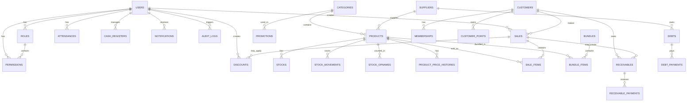

# RetailPOS Pro - Database Schema & Entity Relationship Diagram

## 📊 Complete Entity Relationship Diagram (ERD)

## 📋 Tabel-Tabel Utama

### 1. **USERS**
- Menyimpan data pengguna sistem
- Terintegrasi dengan Spatie Permission untuk RBAC
- Roles: Owner, Admin, Employee/Kasir

| Kolom | Tipe | Deskripsi |
|-------|------|-----------|
| id | BIGINT | Primary Key |
| name | VARCHAR(255) | Nama user |
| email | VARCHAR(255) | Email unik |
| password | VARCHAR(255) | Password terenkripsi |
| phone | VARCHAR(20) | Nomor telepon |
| address | TEXT | Alamat |
| email_verified_at | TIMESTAMP | Verifikasi email |
| remember_token | VARCHAR(100) | Token remember me |
| created_at | TIMESTAMP | Waktu dibuat |
| updated_at | TIMESTAMP | Waktu diupdate |
| deleted_at | TIMESTAMP | Soft delete |

### 2. **PRODUCTS**
- Data master produk dengan multi-price support
- Integrasi dengan kategori dan supplier
- Track stok real-time

| Kolom | Tipe | Deskripsi |
|-------|------|-----------|
| id | BIGINT | Primary Key |
| barcode | VARCHAR(255) | Barcode unik |
| sku | VARCHAR(255) | SKU unik |
| name | VARCHAR(255) | Nama produk |
| category_id | BIGINT | FK Category |
| supplier_id | BIGINT | FK Supplier |
| cost_price | BIGINT | Harga modal |
| retail_price | BIGINT | Harga retail |
| small_reseller_price | BIGINT | Harga reseller kecil |
| large_reseller_price | BIGINT | Harga reseller besar |
| employee_price | BIGINT | Harga karyawan |
| stock | INTEGER | Stok tersedia |
| minimum_stock | INTEGER | Stok minimum |
| is_active | BOOLEAN | Status aktif |
| created_at | TIMESTAMP | Waktu dibuat |
| updated_at | TIMESTAMP | Waktu diupdate |
| deleted_at | TIMESTAMP | Soft delete |

### 3. **SALES (Penjualan)**
- Track semua transaksi penjualan
- Support multiple payment methods
- Calculate profit automatically

| Kolom | Tipe | Deskripsi |
|-------|------|-----------|
| id | BIGINT | Primary Key |
| invoice_number | VARCHAR(255) | Nomor invoice unik |
| user_id | BIGINT | FK User (kasir) |
| customer_id | BIGINT | FK Customer (opsional) |
| subtotal | BIGINT | Subtotal |
| discount_amount | BIGINT | Nominal diskon |
| tax_amount | BIGINT | Nominal pajak |
| total_amount | BIGINT | Total akhir |
| payment_method | ENUM | cash, transfer, qris, debt |
| paid_amount | BIGINT | Jumlah dibayar |
| change_amount | BIGINT | Kembalian |
| payment_status | ENUM | paid, pending, partial |
| status | ENUM | completed, returned, cancelled |
| total_cost | BIGINT | Total harga modal (untuk profit) |
| completed_at | TIMESTAMP | Waktu selesai |
| created_at | TIMESTAMP | Waktu dibuat |

### 4. **SALE_ITEMS**
- Detail item dalam setiap transaksi
- Capture harga modal saat transaksi (untuk kalkulasi profit akurat)

| Kolom | Tipe | Deskripsi |
|-------|------|-----------|
| id | BIGINT | Primary Key |
| sale_id | BIGINT | FK Sale |
| product_id | BIGINT | FK Product |
| quantity | INTEGER | Jumlah |
| unit_price | BIGINT | Harga satuan |
| cost_price | BIGINT | Harga modal saat transaksi |
| discount_amount | BIGINT | Diskon item |
| final_price | BIGINT | Harga final |

### 5. **STOCK_MOVEMENTS**
- Track semua pergerakan stok
- Types: in, out, adjustment, return, opname

| Kolom | Tipe | Deskripsi |
|-------|------|-----------|
| id | BIGINT | Primary Key |
| product_id | BIGINT | FK Product |
| user_id | BIGINT | FK User (yg melakukan) |
| type | ENUM | in, out, adjustment, return, opname |
| quantity | INTEGER | Jumlah perubahan |
| reference_type | VARCHAR(255) | Tipe referensi |
| reference_id | BIGINT | ID referensi |
| reason | TEXT | Alasan perubahan |
| created_at | TIMESTAMP | Waktu dibuat |

### 6. **PRODUCT_PRICE_HISTORIES**
- MANDATORY: Track SEMUA perubahan harga modal
- Data tidak boleh dihapus (audit trail)
- Untuk kalkulasi profit dengan harga modal berlaku saat transaksi

| Kolom | Tipe | Deskripsi |
|-------|------|-----------|
| id | BIGINT | Primary Key |
| product_id | BIGINT | FK Product |
| user_id | BIGINT | FK User (yg mengubah) |
| price_type | VARCHAR(255) | cost, retail, dll |
| old_price | BIGINT | Harga lama |
| new_price | BIGINT | Harga baru |
| reason | TEXT | Alasan perubahan |
| changed_at | TIMESTAMP | Waktu perubahan |

### 7. **RECEIVABLES (Piutang Pelanggan)**
- Track piutang dari pelanggan
- Support pembayaran parsial

| Kolom | Tipe | Deskripsi |
|-------|------|-----------|
| id | BIGINT | Primary Key |
| customer_id | BIGINT | FK Customer |
| sale_id | BIGINT | FK Sale (opsional) |
| amount | BIGINT | Nominal piutang |
| paid_amount | BIGINT | Nominal dibayar |
| status | ENUM | pending, partial, paid, overdue |
| due_date | DATE | Jatuh tempo |
| created_at | TIMESTAMP | Waktu dibuat |

### 8. **DEBTS (Hutang ke Supplier)**
- Track hutang ke supplier
- Support pembayaran parsial

| Kolom | Tipe | Deskripsi |
|-------|------|-----------|
| id | BIGINT | Primary Key |
| supplier_id | BIGINT | FK Supplier |
| amount | BIGINT | Nominal hutang |
| paid_amount | BIGINT | Nominal dibayar |
| status | ENUM | pending, partial, paid, overdue |
| due_date | DATE | Jatuh tempo |
| created_at | TIMESTAMP | Waktu dibuat |

### 9. **CUSTOMERS**
- Data pelanggan dengan tipe
- Support membership system

| Kolom | Tipe | Deskripsi |
|-------|------|-----------|
| id | BIGINT | Primary Key |
| name | VARCHAR(255) | Nama pelanggan |
| phone | VARCHAR(20) | Nomor telepon |
| email | VARCHAR(255) | Email |
| address | TEXT | Alamat |
| type | ENUM | retail, small_reseller, large_reseller, employee |
| is_active | BOOLEAN | Status aktif |

### 10. **MEMBERSHIPS**
- Membership levels: Silver, Gold, Platinum
- Track loyalty points dan discount khusus

| Kolom | Tipe | Deskripsi |
|-------|------|-----------|
| id | BIGINT | Primary Key |
| customer_id | BIGINT | FK Customer (unik) |
| level | ENUM | silver, gold, platinum |
| discount_percentage | INTEGER | Diskon member |
| loyalty_points | INTEGER | Poin loyalitas |
| total_spent | BIGINT | Total belanja |

### 11. **CASH_REGISTERS (Kas Harian)**
- Track pembukaan dan penutupan kas
- Calculate selisih kas otomatis

| Kolom | Tipe | Deskripsi |
|-------|------|-----------|
| id | BIGINT | Primary Key |
| user_id | BIGINT | FK User (kasir) |
| opening_balance | BIGINT | Saldo awal |
| closing_balance | BIGINT | Saldo akhir |
| total_sales | BIGINT | Total penjualan |
| cash_difference | BIGINT | Selisih kas |
| status | ENUM | open, closed |
| opened_at | TIMESTAMP | Waktu buka |
| closed_at | TIMESTAMP | Waktu tutup |

### 12. **DISCOUNTS**
- Track semua diskon yang diberikan
- Support approval untuk diskon besar

| Kolom | Tipe | Deskripsi |
|-------|------|-----------|
| id | BIGINT | Primary Key |
| sale_id | BIGINT | FK Sale |
| user_id | BIGINT | FK User (pemberi diskon) |
| approved_by | BIGINT | FK User (approver) |
| amount | BIGINT | Nominal diskon |
| percentage | DECIMAL | Persentase diskon |
| reason | VARCHAR(255) | Alasan diskon |
| status | ENUM | applied, pending_approval, approved |
| created_at | TIMESTAMP | Waktu dibuat |

### 13. **PROMOTIONS (Program Promo)**
- Time-based promotions
- Support per produk atau per kategori

| Kolom | Tipe | Deskripsi |
|-------|------|-----------|
| id | BIGINT | Primary Key |
| name | VARCHAR(255) | Nama promo |
| code | VARCHAR(255) | Kode unik |
| type | ENUM | product, category, total |
| product_id | BIGINT | FK Product (opsional) |
| category_id | BIGINT | FK Category (opsional) |
| discount_type | ENUM | fixed, percentage |
| discount_value | BIGINT | Nilai diskon |
| start_date | DATE | Tanggal mulai |
| end_date | DATE | Tanggal selesai |
| start_time | TIME | Jam mulai (opsional) |
| end_time | TIME | Jam selesai (opsional) |
| is_active | BOOLEAN | Status aktif |

### 14. **BUNDLES (Paket Bundling)**
- Beli 3 Gratis 1, Paket Hemat, dll
- Track items dalam bundle

| Kolom | Tipe | Deskripsi |
|-------|------|-----------|
| id | BIGINT | Primary Key |
| name | VARCHAR(255) | Nama bundle |
| code | VARCHAR(255) | Kode bundle |
| bundle_price | BIGINT | Harga bundle |
| regular_price | BIGINT | Harga normal |
| start_date | DATE | Tanggal mulai |
| end_date | DATE | Tanggal selesai |
| is_active | BOOLEAN | Status aktif |

### 15. **BUNDLE_ITEMS**
- Items dalam setiap bundle

| Kolom | Tipe | Deskripsi |
|-------|------|-----------|
| id | BIGINT | Primary Key |
| bundle_id | BIGINT | FK Bundle |
| product_id | BIGINT | FK Product |
| quantity | INTEGER | Jumlah dalam bundle |

### 16. **CUSTOMER_POINTS**
- Track poin belanja pelanggan
- Earn: Rp10.000 = 1 poin
- Redeem: Voucher, Diskon, Produk Gratis

| Kolom | Tipe | Deskripsi |
|-------|------|-----------|
| id | BIGINT | Primary Key |
| customer_id | BIGINT | FK Customer |
| sale_id | BIGINT | FK Sale (opsional) |
| type | ENUM | earn, redeem, expire |
| points_earned | INTEGER | Poin diterima |
| points_redeemed | INTEGER | Poin digunakan |
| balance | INTEGER | Saldo poin |
| expires_at | TIMESTAMP | Kadaluarsa |

### 17. **ATTENDANCES (Absensi Karyawan)**
- Check in & check out
- Status: present, absent, late, sick, permit

| Kolom | Tipe | Deskripsi |
|-------|------|-----------|
| id | BIGINT | Primary Key |
| user_id | BIGINT | FK User |
| attendance_date | DATE | Tanggal absensi |
| check_in_time | TIME | Jam masuk |
| check_out_time | TIME | Jam pulang |
| status | ENUM | present, absent, late, early_leave, sick, permit |
| work_hours | INTEGER | Jam kerja (menit) |
| notes | TEXT | Catatan |

### 18. **STOCK_OPNAMES**
- Inventaris hitung stok fisik
- Compare dengan stok sistem
- Require approval

| Kolom | Tipe | Deskripsi |
|-------|------|-----------|
| id | BIGINT | Primary Key |
| product_id | BIGINT | FK Product |
| user_id | BIGINT | FK User (yg hitung) |
| system_quantity | INTEGER | Stok sistem |
| physical_quantity | INTEGER | Stok fisik |
| status | ENUM | draft, counted, approved, rejected |
| approved_by | BIGINT | FK User (approver) |
| approved_at | TIMESTAMP | Waktu approval |

### 19. **AUDIT_LOGS**
- Track SEMUA aktivitas sistem
- Immutable record

| Kolom | Tipe | Deskripsi |
|-------|------|-----------|
| id | BIGINT | Primary Key |
| user_id | BIGINT | FK User |
| action | VARCHAR(255) | Jenis aksi |
| model_type | VARCHAR(255) | Model yang diubah |
| model_id | BIGINT | ID model |
| old_values | JSON | Nilai lama |
| new_values | JSON | Nilai baru |
| ip_address | VARCHAR(45) | IP user |
| user_agent | TEXT | Browser info |
| created_at | TIMESTAMP | Waktu aksi |

### 20. **NOTIFICATIONS**
- In-app notifications
- Types: info, warning, error, success

| Kolom | Tipe | Deskripsi |
|-------|------|-----------|
| id | BIGINT | Primary Key |
| user_id | BIGINT | FK User |
| title | VARCHAR(255) | Judul notifikasi |
| message | TEXT | Isi notifikasi |
| type | ENUM | info, warning, error, success |
| is_read | BOOLEAN | Status baca |
| read_at | TIMESTAMP | Waktu dibaca |

---

## 🔗 Key Relationships

### One-to-Many
- User → Sales (1 kasir banyak transaksi)
- User → Attendances (1 karyawan banyak absensi)
- Product → StockMovements (1 produk banyak gerakan stok)
- Customer → Sales (1 pelanggan banyak transaksi)
- Sale → SaleItems (1 transaksi banyak item)
- Receivable → ReceivablePayments (1 piutang banyak pembayaran)

### Many-to-Many
- Users ↔ Roles (via model_has_roles)
- Users ↔ Permissions (via model_has_permissions)
- Roles ↔ Permissions (via role_has_permissions)

### Virtual Columns
- Stock.available_quantity = quantity - reserved_quantity
- SaleItem.subtotal = quantity * unit_price
- Bundle.savings = regular_price - bundle_price
- Receivable.remaining_amount = amount - paid_amount
- Debt.remaining_amount = amount - paid_amount

---

## 📊 Key Indexes
- products.sku, barcode, category_id, is_active
- sales.invoice_number, user_id, customer_id, created_at
- stock_movements.product_id, type, created_at
- receivables.customer_id, status, due_date
- debts.supplier_id, status, due_date
- audit_logs.user_id, action, created_at

---

## 🔐 Data Integrity Rules
1. **Soft Deletes**: Produk, Supplier, Customer, Discount, Promotion, Bundle, Receivable, Debt
2. **Cascade Delete**: StockMovement, SaleItem, BundleItem jika parent dihapus
3. **Set Null**: FK optional fields jika parent dihapus
4. **Immutable**: ProductPriceHistory, AuditLog, StockMovement
5. **Unique Constraints**: barcode, sku, email, invoice_number, promotion.code, bundle.code

